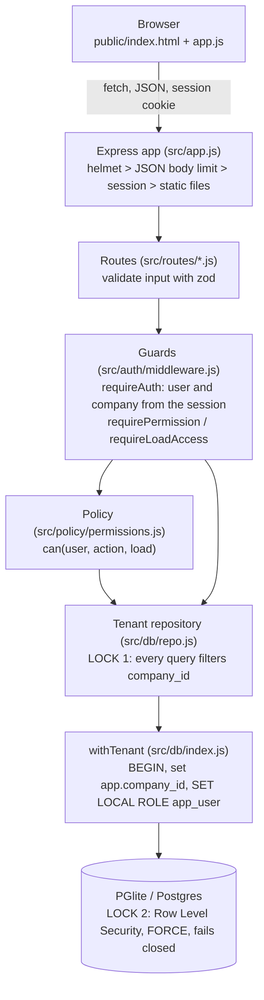
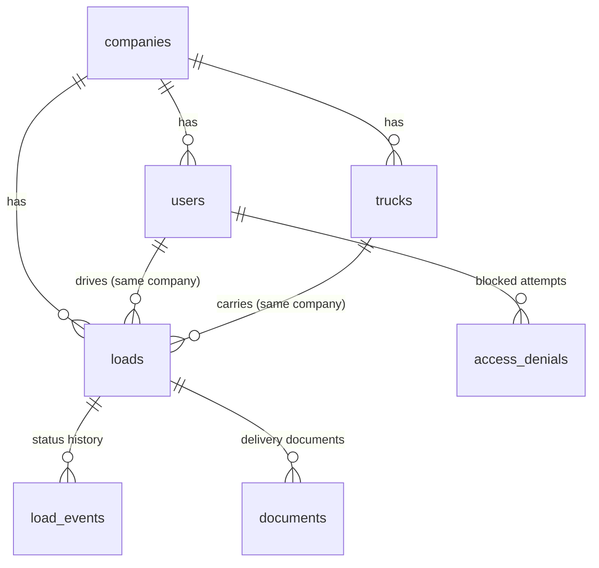

# Architecture

This covers submission items 3 (architecture), 4 (tenant isolation) and 5 (role permissions), plus the threat model and the reasons behind each decision.

## In one paragraph

A Node.js + Express JSON API over Postgres, with a plain HTML and JavaScript page on top. Postgres runs inside the Node process through PGlite (real Postgres compiled to WebAssembly), so the project needs no database server and runs the same on Replit, a laptop and GitHub Actions. Every company's data lives in the same tables, tagged with `company_id`. Two independent locks keep companies apart: the application only ever asks for the logged-in user's company (Lock 1), and Postgres Row Level Security refuses any other company's rows even if the application forgets to ask (Lock 2). Role rules sit in one permission table that every route uses.

## The layers



| Layer | File | Its one job |
|---|---|---|
| Boot | `src/server.js` | Clear old upload files, build the database, load sample data, start listening |
| App | `src/app.js` | Security headers, body size limit, session cookie, mount routes, JSON errors |
| Routes | `src/routes/auth.js`, `loads.js`, `fleet.js`, `documents.js`, `audit.js` | Turn HTTP into calls on the repository, turn rows into JSON |
| Guards | `src/auth/middleware.js` | Who is logged in, which company, may they do this |
| Policy | `src/policy/permissions.js`, `workflow.js` | Role table, driver rule, next status. Pure functions, no database |
| Repository | `src/db/repo.js` | The only place application code touches tenant data |
| Database | `src/db/index.js`, `schema.sql`, `rls.sql`, `seed.js` | Tables, constraints, policies, sample data, the per-request transaction |
| Helpers | `src/http/*.js`, `src/storage.js`, `src/config.js` | Errors, input rules, JSON shapes, file storage, settings |

## One request, start to finish

"Dana (Alpha Transport owner) asks for load 5, which belongs to Beta Logistics":

1. The browser sends `GET /api/loads/5` with Dana's session cookie.
2. `requireAuth` reads only the user id from the server-side session, then loads Dana from the `users` table. Her company (Alpha, id 1) comes from that row. Nothing the browser sends can change it.
3. `requireLoadAccess('load:view')` checks that `5` is a plain positive number, then calls `repo.getLoad(5)`.
4. The repository runs `... WHERE l.company_id = $1 AND l.id = $2` with `$1 = 1` (Lock 1).
5. That query runs inside `withTenant`: a transaction that sets `app.company_id = 1` and switches to the `app_user` role, so Postgres also applies `company_id = 1` to every table it reads (Lock 2).
6. Zero rows come back. The attempt is written to the blocked log for Alpha's owner.
7. The response is `404 {"error":"Not found"}`, exactly what a load id that does not exist returns.

## Tenant isolation: the two locks

### Lock 1: the application only asks for your company

- The company id is set at login from the `users` table and is read again from the database on every request (`findUserById` in `requireAuth`). The session stores only the user id.
- All tenant data access goes through `tenantRepo(db, user)` in `src/db/repo.js`. Every SQL statement in that file filters `company_id = $n` with the session user's company, and joins repeat the filter (`u.company_id = l.company_id`), so a row can never join to another company's row. Driver reads also add `driver_id = <user id>`.
- No route reads `company_id` from the query string, body or headers. Tests send it in all three and it is ignored.
- Documented exceptions, each with a reason in the code: `findUserForLogin` (runs before the company is known), `findUserById` (is the source of the company), `seed.js` (inserts sample data at startup), and tests that query the database on purpose.

### Lock 2: the database refuses other companies' rows

`src/db/rls.sql` switches on Postgres Row Level Security for all seven tables:

```sql
ALTER TABLE loads ENABLE ROW LEVEL SECURITY;
ALTER TABLE loads FORCE ROW LEVEL SECURITY;
CREATE POLICY tenant_isolation ON loads
  USING (company_id = NULLIF(current_setting('app.company_id', true), '')::int)
  WITH CHECK (company_id = NULLIF(current_setting('app.company_id', true), '')::int);
```

- Every request's queries run inside `withTenant`, which opens a transaction, sets `app.company_id` with `set_config(..., true)` (a bound parameter, never string-built SQL) and switches to `app_user` with `SET LOCAL ROLE`. Both settings end when the transaction ends, so one request's company can never carry into the next.
- `app_user` is neither the table owner nor a superuser, and has only the grants the app needs: no DELETE anywhere, UPDATE only on the `status` column of loads (a column-level grant, tested), no INSERT into users, trucks or loads.
- Switching to `app_user` is what makes the policies apply here. In PGlite the tables are owned by the `postgres` superuser, and superusers always skip Row Level Security, so the app never reads tenant data as the owner. Only the two login lookups and the seed do, and each is documented. `FORCE` is kept for hosted Postgres, where an app might connect as the table owner: there it stops the owner skipping the policies.
- Fails closed: if the company setting is missing, `NULLIF` makes it NULL, `company_id = NULL` is never true, and the query sees nothing.
- `WITH CHECK` stops writes as well as reads: inserting a row for another company raises an error, and updating another company's row changes 0 rows.

### A third net: composite foreign keys

`loads`, `load_events`, `documents` and `access_denials` point at their parent with `(id, company_id)` pairs, for example `FOREIGN KEY (driver_id, company_id) REFERENCES users(id, company_id)`. The database itself will not store an Alpha load assigned to a Beta driver, or a history row for an Alpha load written by a Beta user.

### How each lock is proven on its own

| Test | What it switches off | What it proves |
|---|---|---|
| `test/rls.test.js` | All application code (raw SQL only) | Lock 2 alone: unfiltered SELECT sees one company, cross UPDATE changes 0 rows, cross INSERT is rejected, no company set returns nothing, the foreign key refuses a cross-company driver |
| `test/lock1.test.js` | Row Level Security (`enforceRls: false`, allowed only when `NODE_ENV=test`) | Lock 1 alone: a control query sees all 8 loads, yet the API still returns only Alpha loads and 404 for Beta ones |
| `test/isolation.test.js`, `test/matrix.test.js`, `npm run security-test` | Nothing | Both locks together through the real API |

During the build each lock was also broken on purpose to check the tests notice. With the repository's company filter removed, `lock1.test.js` failed 2 tests while `isolation.test.js` (RLS on) still passed 8 of 8. With both locks broken, `npm run security-test` reported 18 leaks and exited with code 1.

## Role permissions

One table in `src/policy/permissions.js`, one function `can(user, action, load)`, used by every route through two guards:

| Action | Owner | Dispatcher | Driver |
|---|---|---|---|
| `fleet:view` (drivers, trucks lists) | Yes | Yes | No, 403 |
| `load:view` | Any load in own company | Any load in own company | Only loads assigned to them |
| `load:advance` (one step forward) | Yes | Yes | Own loads only |
| `doc:upload`, `doc:view` | Yes | Yes | Own loads only |
| `audit:view` (blocked log) | Yes | No, 403 | No, 403 |
| Anything in the other company | 404 | 404 | 404 |

- `requirePermission(action)` guards routes that are not about one load (fleet lists, blocked log). Wrong role in your own company is `403 {"error":"Forbidden"}`.
- `requireLoadAccess(action)` guards routes about one load. It loads the load through the repository, then applies `can()`. Another company's load, another driver's load and a missing id all return the same `404`.
- `can()` denies by default: an unknown action or role is refused, and the table is frozen so it cannot be changed at runtime.
- The driver rule lives in two places on purpose: the repository only returns a driver's own loads, and `can()` checks `load.driver_id === user.id`.
- The status workflow is server-side: `nextStatus()` picks the next step, so a load cannot skip a step or move backwards. The browser sends only `{"from": "<status on screen>"}`, never the status to move to.
- If the load is no longer at that status (a double click, or a colleague moved it first), the answer is `409 This load has changed`. The check runs on a row locked with `SELECT ... FOR UPDATE`, in the same transaction that writes the history row, so ten clicks at the same moment move the load exactly one step (tested). The button is also disabled while its request runs.
- A load cannot be marked Delivered until a delivery document (POD) is on file: `409 Upload the delivery document (POD) before marking Delivered`.
- Every 403 and 404 is logged to `access_denials`. The owner sees their own company's blocked attempts in the Blocked log tab.

## Data model



| Table | Key columns | Notes |
|---|---|---|
| companies | id, name | Alpha Transport (1), Beta Logistics (2) |
| users | id, company_id, email, password_hash, role | role is owner, dispatcher or driver; bcrypt hashes |
| trucks | id, company_id, unit | |
| loads | id, company_id, ref, origin, destination, driver_id, truck_id, status | status is Assigned, Picked Up or Delivered |
| load_events | company_id, load_id, from_status, to_status, user_id, at | who moved what, when |
| documents | company_id, load_id, filename, stored_name, mime, size_bytes, uploaded_by | append-only; the newest row is the current POD |
| access_denials | company_id, user_id, method, path, status, at | 403 and 404 answers |

Indexes lead with `company_id` (for example `loads (company_id, driver_id)`), because every query filters on it first.

## Threat model

| Threat | Example | Control | Proven by |
|---|---|---|---|
| Cross-company read | Alpha user GETs a Beta load id | Lock 1 + Lock 2, 404 | isolation, matrix, security-test |
| Cross-company write | Alpha user advances or uploads to a Beta load | Lock 1 + Lock 2 WITH CHECK + composite foreign keys | isolation, documents, rls, security-test write check |
| Tenant spoofing | `company_id` in the query, body or a header | Company read only from the session user's database row | isolation, security-test |
| A developer forgets the filter | A future query without `company_id` | Lock 2 still filters | rls (unfiltered queries), the mutation check above |
| Role escalation | Driver calls `/api/drivers` | `can()` on every route | roles, matrix |
| Driver reads a coworker's load | Guessing ids | Repository driver filter + `can()` | roles, matrix |
| Enumeration | Probing ids to see which exist | Same 404 for missing, foreign and coworker loads | isolation |
| Password guessing | Brute force | bcrypt (cost 10); 10 failures per account and 50 per IP per 15 minutes; same 401 and similar timing for unknown emails | auth |
| Forged client IP | Rotating `X-Forwarded-For` to reset the limit | Proxy trusted only on Replit or when `TRUST_PROXY` is set; per-account limit ignores IPs | auth |
| Session fixation or theft | Planted session id, script reading the cookie | Session regenerated at login; httpOnly, SameSite=Strict, Secure when deployed; CSP | auth |
| Malicious upload | .exe renamed .pdf, huge file, `../` in the name, a PDF hiding HTML | File signature check, 5 MB cap, random stored names in a per-company folder, forced download with nosniff and a sandbox CSP | documents |
| SQL injection | id = `1 OR 1=1` | Strict id pattern, parameterized queries everywhere, `set_config` with a parameter | isolation |
| Stored XSS | Script in a file name | File names cleaned on upload; the page inserts all text with `textContent`, never `innerHTML` | documents, code review |
| Skipping a status | Assigned straight to Delivered | Server computes the next status; the body only says which status the user saw | workflow |
| Double click or stale screen | Two clicks move a load two steps | `{from}` checked on a locked row, 409 if it changed; button disabled while pending | workflow (10 parallel clicks, 1 move) |
| Delivered with no proof | Marking Delivered before any POD exists | Server refuses Delivered until a document is on file | workflow, matrix |
| App role does more than intended | Changing a load's driver or company through the status update | Column-level grant: app_user may update `status` only | rls |

## Decisions and why

**PGlite instead of SQLite or a hosted Postgres.** Tenant isolation was the most important requirement, and Row Level Security is a Postgres feature, so the database had to be Postgres. SQLite has no RLS, so it would have left one lock only. A hosted Postgres would need an account, a connection string and network access from whoever reviews this. PGlite is real Postgres running inside Node with nothing to install. The same `schema.sql` and `rls.sql` run unchanged on hosted Postgres; only the connection code changes.

**404, not 403, across companies.** A 403 says "this exists but you may not see it", which confirms that Beta has a load with that id. A 404 that matches a missing record tells an attacker nothing. Inside your own company a wrong role gets 403, because there is nothing to hide from a colleague about whether the drivers list exists.

**Plain integer ids, on purpose.** Random ids (UUIDs) would make guessing harder, but isolation must never depend on ids being secret. Keeping simple sequential ids makes the security test meaningful: the ids are easy to guess and the server still refuses.

**Server sessions instead of JWTs.** Logout takes effect immediately (the session is destroyed on the server), nothing sensitive is stored in the browser, and the cookie is httpOnly so page scripts cannot read it. The cost is server-side state, which is why the deployment must run a single instance (see Known issues in the README).

**Company from the database on every request.** The session holds only the user id. Reading the user, and so the company and role, fresh each time means a role change or a removed user takes effect on the next click.

**Two login limits.** The per-account limit (10 failures per email per 15 minutes) stops brute force from any number of IPs. The per-IP limit (50) stops one source spraying a password across many accounts, and is set high enough that one person's typos do not lock out colleagues on the same office network. Accepted trade-off: anyone who knows an email can keep that one account locked by sending 10 bad guesses every 15 minutes. Production would replace the hard block with a CAPTCHA or email unlock, and keep the counters in a shared store.

**Trusting the proxy only on Replit.** On Replit the app sits behind one TLS proxy, so it trusts one hop to read the real client IP and to set secure cookies. Run directly, it trusts none, so nobody can pick their own IP with a forged header. This was a finding from the security review, fixed with a test.

**Upload checks before the file is read.** The route checks login, the load and the role before multer reads a single byte, so a foreign or anonymous upload is refused without accepting the file. The file type is decided by its first bytes, not by its name or the browser's claim.

**Owner and dispatcher are close on purpose.** In a small carrier the dispatcher runs the day: loads, drivers, trucks, status, paperwork. So in this prototype both can do all of that, and the owner adds oversight (the Blocked log). The brief's features are all operational, so there was nothing else to split. In production the owner would also get user management, billing and company settings: new rows in the same permission table, with no other code changes.

**No delivery without a POD.** In trucking, a load is not really delivered until there is proof of delivery, and the POD is what the customer gets invoiced against. Making the server refuse Delivered until a document is on file ties requirement 6 (documents) to requirement 5 (workflow).

**The browser sends the status it saw, not the status it wants.** The server still decides the next step, but it refuses if the load has moved since the screen was drawn. This is optimistic concurrency: no locks held between requests, and a clear 409 instead of a silent double move. The first version did not have this, and the hiring-manager review caught a double click moving a load two steps. The test that reproduces it now passes.

**Append-only documents.** A new POD upload adds a row instead of replacing one. The newest row is the current document and older ones stay as history. This also means the app needs no UPDATE or DELETE permission on documents.

**Replit preview allowed to frame the app.** Helmet normally blocks all framing. The CSP `frame-ancestors` rule allows only this site and `replit.com`, so the Replit workspace preview pane works and every other site is still refused.

**No front-end framework.** The page is one plain JavaScript file (about 700 lines, mostly small render functions) with no build step. The brief grades the backend, and anyone can read the page code without knowing a framework.

## Going to production

The same design scales to hundreds of companies: one shared database, `company_id` on every row, RLS policies, indexes that start with `company_id`. The changes would be:

- Hosted Postgres (Replit Postgres or Neon) through the `pg` package. The app would connect as a non-owner, non-superuser role (today PGlite connects as a superuser, and the app switches to `app_user` for every tenant query). The login lookup would become a small `SECURITY DEFINER` function, because RLS on `users` would otherwise hide every user before the company is known.
- A Postgres-backed session store and a shared rate-limit store, so the app can run more than one instance.
- Object storage with short-lived signed URLs for documents.
- Screens to create loads, assign drivers and invite users, each going through the same repository and permission table.
- Browser tests (Playwright) in CI alongside the API tests.
