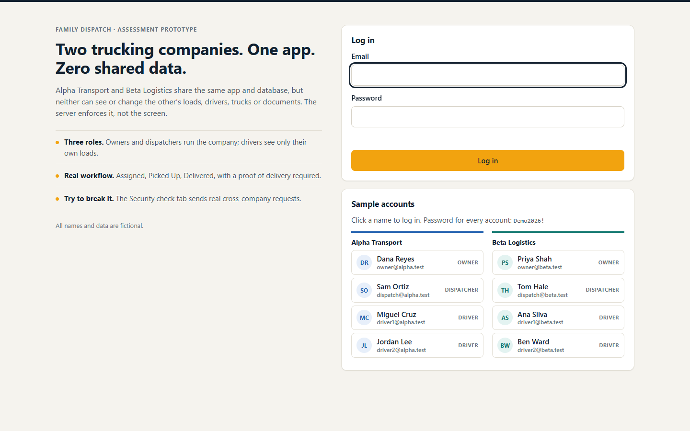
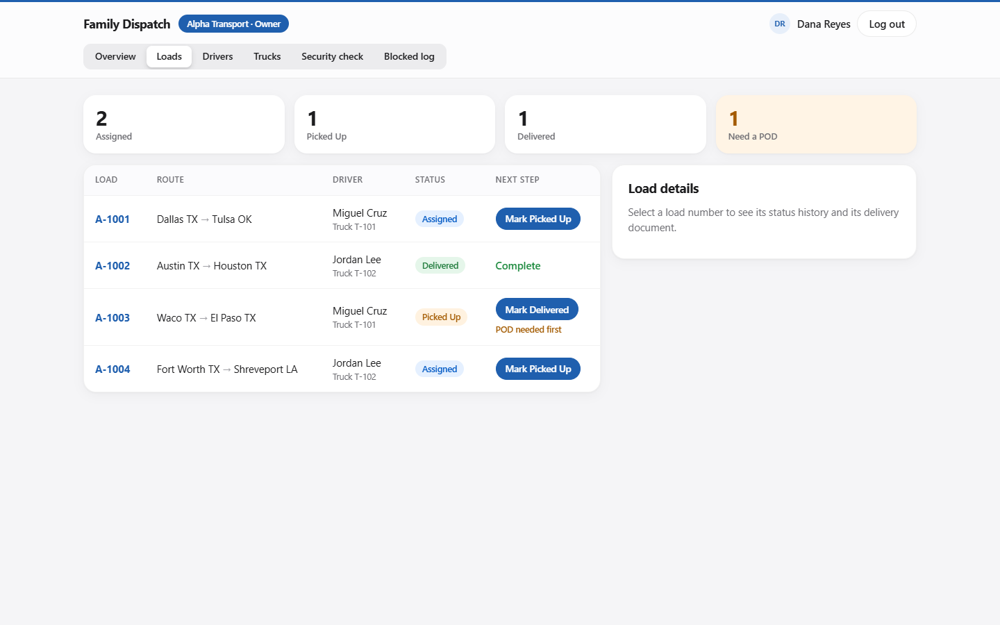
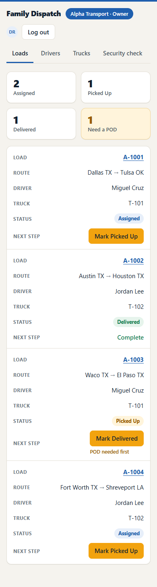
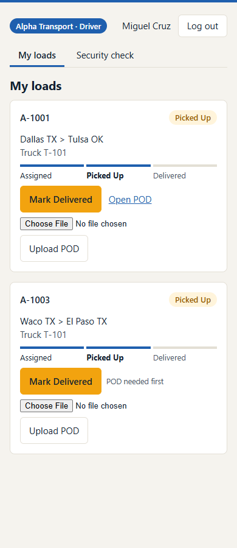
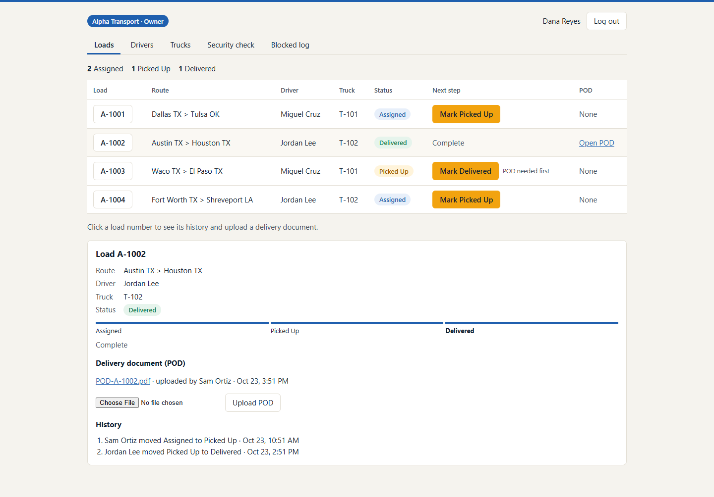
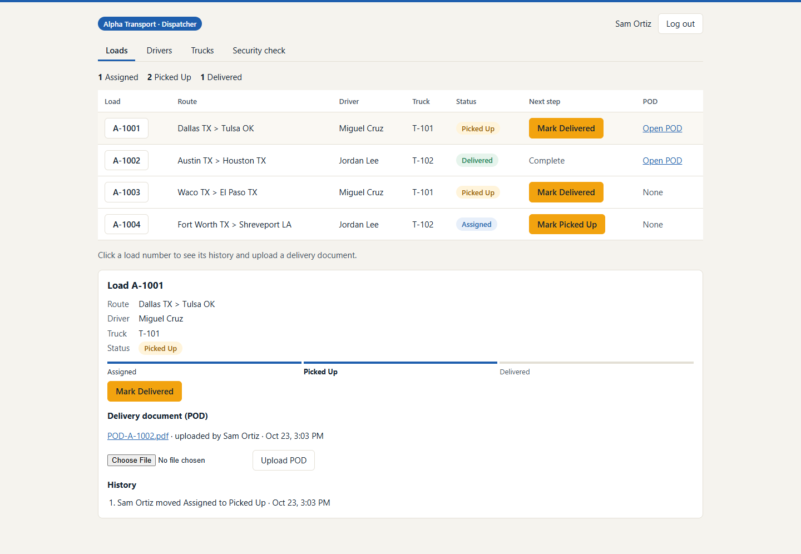
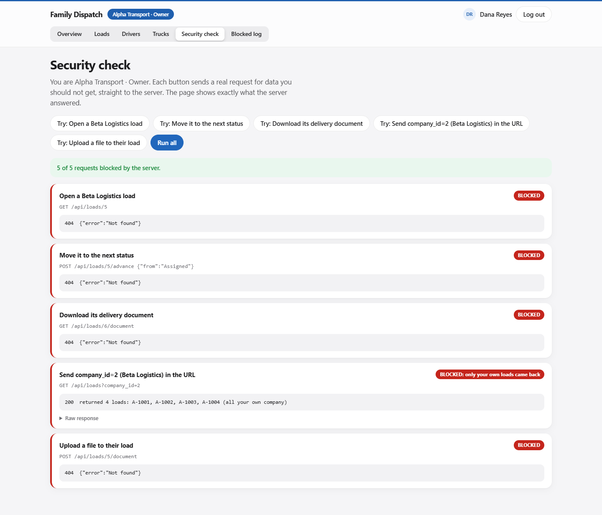
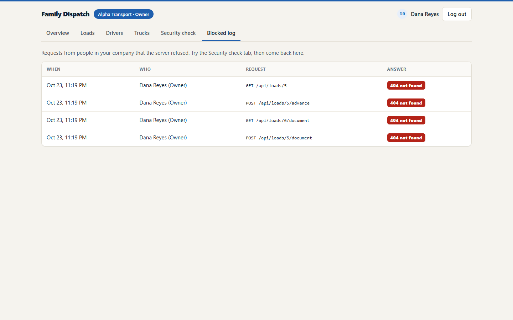

# Walkthrough

**Recorded walkthrough:** _video link added after recording_

This is the written version. It follows the brief's eight required functions in order, with screenshots from a run of the app in headless Chrome (all in [screenshots/](screenshots/)).

## 1. Login

Each sample user logs in with an email and password. Passwords are stored as bcrypt hashes. On success the server starts a new session (a fresh session id, so a planted one is useless) and sets an httpOnly, SameSite=Strict cookie. A wrong password and an unknown email get the same `401 Invalid email or password`, so the login form cannot be used to discover accounts. Failed logins are limited per account and per IP.

The login page lists the eight sample accounts. Click a name to log in.

## 2. Role-based access

The coloured stripe at the top and the chip ("Alpha Transport · Owner") always show whose data is on screen: navy for Alpha, teal for Beta.

- **Owner:** Loads, Drivers, Trucks, Security check, Blocked log.
- **Dispatcher:** the same without the Blocked log.
- **Driver:** My loads and Security check only.

Hiding tabs is only the visible part. The server checks every request against one permission table (`src/policy/permissions.js`). A driver who calls `/api/drivers` directly gets `403 Forbidden`, and the attempt is logged.

## 3. Company dashboard

The owner and dispatcher see their own company's loads with counts by status, plus the Drivers and Trucks tabs. Every query behind these screens filters by the company taken from the session, and Postgres Row Level Security filters again.

On a phone the table becomes one card per load:

## 4. Driver view

A driver sees only the loads assigned to them, as large cards made for a phone. Miguel Cruz sees A-1001 and A-1003, never Jordan Lee's loads. Asking the API for a coworker's load returns 404.

## 5. Load status workflow

Each load shows a three-step tracker and one button for the next step: **Mark Picked Up**, then **Mark Delivered**. The browser never sends a status. The server works out the next one, so a load cannot skip a step or go backwards. A Delivered load answers 409. Every move is recorded with who made it and when.

## 6. Delivery document

Owners, dispatchers and the assigned driver can upload a POD (PDF, PNG or JPG, up to 5 MB) to a load and download it again. The server:

- checks login, the load and the role before reading the file;
- checks the file's first bytes, so an .exe renamed to .pdf is refused;
- stores it under a random name in that company's folder;
- always serves it as a download.

A-1002 and B-2002 start with a fake POD from the sample data.

## 7. Multi-tenant security

Two independent locks, explained in full in [ARCHITECTURE.md](ARCHITECTURE.md#tenant-isolation-the-two-locks):

1. **Application:** the company id comes only from the logged-in user's database row. Every query in the one data-access file (`src/db/repo.js`) filters by it. Anything the browser sends as `company_id` is ignored.
2. **Database:** Postgres Row Level Security on every table, forced on, running as a role that does not own the tables, with the company set per request inside a transaction. If application code ever forgot the filter, the database would still return nothing from the other company.

Each lock has a test that switches the other one off and proves it still holds.

## 8. Security test

The **Security check** tab sends real requests for the other company's data straight to the API and prints the server's answer. Every one is BLOCKED: 404 for direct requests, and only your own data when you send a forged `company_id`.

The owner can then see those attempts in the **Blocked log**:

The same test runs automatically as `npm run security-test`: 32 cross-company attempts in both directions, then a direct database check that nothing was written. Result: **32 cross-company attempts, 0 leaks** ([SECURITY-TEST.md](SECURITY-TEST.md)). The automated suite adds a matrix test that tries all 8 users against all 8 loads for view, document and advance: 192 checks, 0 unexpected.
